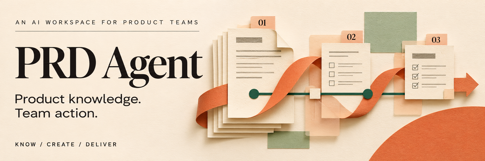
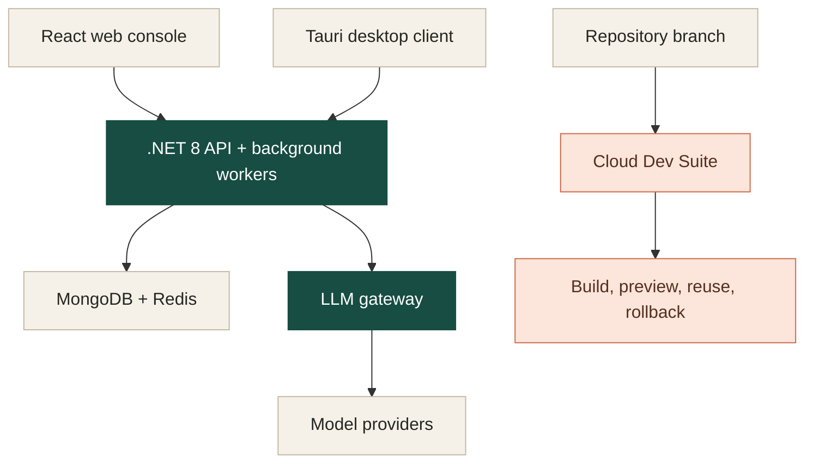

<p align="center">
  
</p>

<p align="center">
  <strong>An AI workspace for product knowledge, creative work, and team execution.</strong><br />
  <sub>Web console · Desktop client · Agent workflows · Model gateway · Branch previews</sub>
</p>

<p align="center">
  <a href="#what-you-can-do">Capabilities</a> &nbsp; / &nbsp;
  <a href="#how-it-fits-together">Architecture</a> &nbsp; / &nbsp;
  <a href="#get-started">Get started</a> &nbsp; / &nbsp;
  <a href="#go-deeper">Documentation</a>
</p>

---

PRD Agent brings product documents, knowledge, defects, reports, reviews, and visual work into a shared workspace. Its supporting infrastructure handles model requests and branch previews, so teams can work with both the product context and the systems that turn it into action.

This repository includes the application, its web and desktop clients, the LLM gateway, Cloud Dev Suite, and the automation that supports them.

## What you can do

<table>
  <tr>
    <td width="50%" valign="top">
      <sub>01 / KNOW</sub>
      <h3>Give the team shared context.</h3>
      <p>Work with Markdown PRDs, document stores, grounded Q&amp;A, citations, comments, and sharing.</p>
    </td>
    <td width="50%" valign="top">
      <sub>02 / OPERATE</sub>
      <h3>Move work through the team.</h3>
      <p>Manage product and defect workflows, run report and review agents, and schedule repeatable automations.</p>
    </td>
  </tr>
  <tr>
    <td width="50%" valign="top">
      <sub>03 / CREATE</sub>
      <h3>Bring ideas into view.</h3>
      <p>Generate images, analyze visual content, illustrate articles, and apply watermarks within the workspace.</p>
    </td>
    <td width="50%" valign="top">
      <sub>04 / DELIVER</sub>
      <h3>Put a working branch in reach.</h3>
      <p>Build branch previews, resume deployment records, reuse successful versions, and roll back through Cloud Dev Suite.</p>
    </td>
  </tr>
</table>

<details>
<summary>Explore the capability map</summary>

| Area | Included capabilities |
| :--- | :--- |
| Product knowledge | PRDs, document stores, Q&A, citations, comments, sharing, and cross-system peer sync |
| Product operations | Requirement, feature, and defect lifecycles; statistics and review loops |
| TAPD reporting | Natural-language defect descriptions become editable bug drafts; submission follows confirmation |
| Reports and reviews | Report agents, review workflows, webhook feedback, and team reporting |
| Creative workflows | Image generation, visual analysis, article illustration, and watermarking |
| Automation | Visual workflow builder, scheduled execution, secrets, and run history |
| Model infrastructure | Model routing, pools, request logs, health scoring, and fallback strategies |
| Branch delivery | Builds, preview routing, resumable records, reusable versions, rollback, and failure guidance |

</details>

## How it fits together

The workspace uses a .NET API and background workers. The LLM gateway manages model execution; Cloud Dev Suite manages branch delivery.



| Component | Responsibility | Source |
| :--- | :--- | :--- |
| Application backend | API, product operations, and background workers | [`prd-api/`](prd-api/) |
| Web console | React interface for the workspace and administration | [`prd-admin/`](prd-admin/) |
| Desktop client | Tauri desktop application | [`prd-desktop/`](prd-desktop/) |
| LLM gateway | Centralized model execution and request governance | [`llmgw/`](llmgw/) |
| Cloud Dev Suite | Branch builds, previews, and delivery records | [`cds/`](cds/) |
| Agent SDK sidecar | Supporting Agent SDK service | [`claude-sdk-sidecar/`](claude-sdk-sidecar/) |

## Get started

### Run the development stack

Use the development Compose stack from a checkout of this repository with Docker and Compose available. On a fresh database, supply `MAP_INITIAL_ADMIN_USERNAME` and `MAP_INITIAL_ADMIN_PASSWORD` through your environment or a local `.env` file; the initializer validates this credential pair before creating the first administrator. See the [environment template](.env.template) for the broader configuration reference.

```bash
docker compose -f docker-compose.dev.yml up -d --build
```

Open **[http://localhost:5500](http://localhost:5500)** for the web console and sign in with that administrator account. Model-backed features also require configured providers and credentials through the gateway.

| Service | Development address |
| :--- | :--- |
| Web gateway and admin console | `http://localhost:5500` |
| API | `http://localhost:5000` |
| MongoDB | `mongodb://localhost:18081` |
| Redis | `localhost:18082` |

<details>
<summary>Local development shortcuts</summary>

Use the existing launchers when developing with the local toolchains and configured infrastructure:

```bash
./quick.sh          # API + local LLM gateway serving
./quick.sh admin    # web console
./quick.sh all      # API + gateway + web console + desktop
```

Windows:

```powershell
.\quick.ps1
.\quick.ps1 all
```

The full desktop workflow uses the .NET, Node/pnpm, Rust, and Tauri development toolchains. Frontend packages use **pnpm**.

</details>

<details>
<summary>Build and check individual modules</summary>

Backend, from `prd-api/`:

```bash
dotnet build --no-restore
dotnet test tests/PrdAgent.Tests/PrdAgent.Tests.csproj --no-restore --filter "Category!=Integration&Category!=Manual"
```

Web console, from `prd-admin/`:

```bash
pnpm install
pnpm dev
pnpm tsc --noEmit
pnpm lint
```

Desktop, from `prd-desktop/`:

```bash
pnpm install
pnpm tauri:dev
```

The test command above selects the non-integration, non-manual suite. See [AGENTS.md](AGENTS.md) for scope-specific checks, CI requirements, and integration test rules.

</details>

<details>
<summary>Start Cloud Dev Suite and manage deployments</summary>

From the repository root:

```bash
./exec_cds.sh init
./exec_cds.sh start
./exec_cds.sh status
```

The CDS initialization flow prepares its configuration. See the [CDS guide](cds/README.md) for Agent onboarding, managed delivery, previews, and recovery.

List the CDS acceptance scenarios:

```bash
./scripts/cds-acceptance-test.sh --list
```

Project deployment entrypoint:

```bash
./exec_dep.sh
```

Local production-like builds:

```bash
./local_exec_dep.sh up
```

Use the deployment entrypoint with the environment configuration for your intended target. The development Compose stack is the local development path.

</details>

## Go deeper

| Start with | Read |
| :--- | :--- |
| Product workflows and agents | [Product Agent design](doc/design.product-agent.md) |
| Model routing and responsibility boundaries | [LLM gateway design](doc/design.platform.llm-gateway.md) |
| Branch previews and managed delivery | [CDS guide](cds/README.md) · [CDS architecture](doc/design.cds.md) |
| Cross-system knowledge sharing | [Peer sync design](doc/design.platform.peer-sync.md) |
| Contributor rules and required checks | [AGENTS.md](AGENTS.md) |
| Changes across releases | [Changelog](CHANGELOG.md) |

<details>
<summary>Repository and documentation conventions</summary>

The root keeps project entrypoints and top-level documentation. Supporting material lives with its owning module:

| Path | Contents |
| :--- | :--- |
| `doc/` | Specifications, designs, plans, rules, guides, reports, and debt notes |
| `scripts/` | Build, smoke, migration, acceptance, and maintenance tooling |
| `e2e/` | Automated tests, manual probes, and test fixtures |
| `assets/` | Static artwork, reference assets, and archived prototypes |
| `.design/` | Editable design sources |
| `changelogs/` | One changelog fragment per change set |
| `deploy/` | Deployment support files |

Documentation uses the prefixes `spec.`, `design.`, `plan.`, `rule.`, `guide.`, `report.`, and `debt.`. See [AGENTS.md](AGENTS.md) for naming, directory, change-record, and quality requirements.

</details>

## License

MIT

---

<p align="center"><sub>PRD Agent &nbsp; / &nbsp; Know the product. Move the work. Deliver the result.</sub></p>
