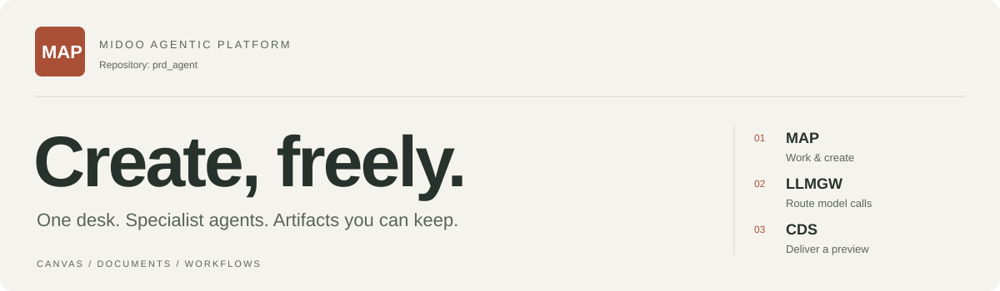
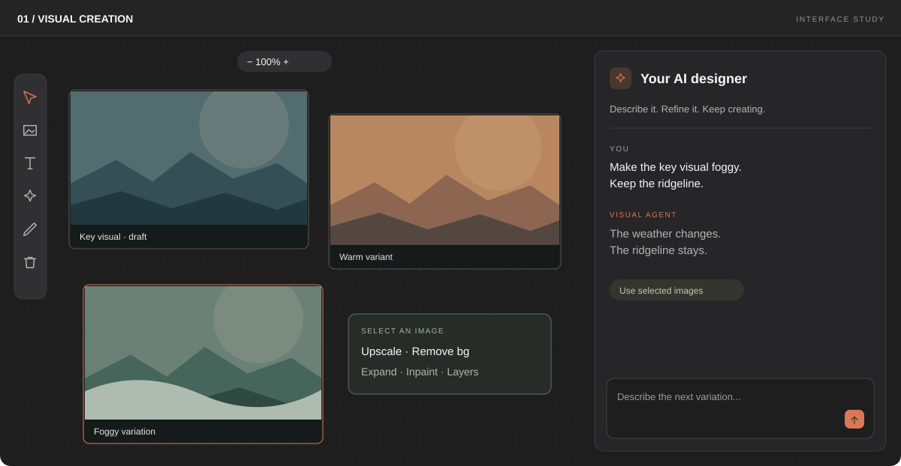
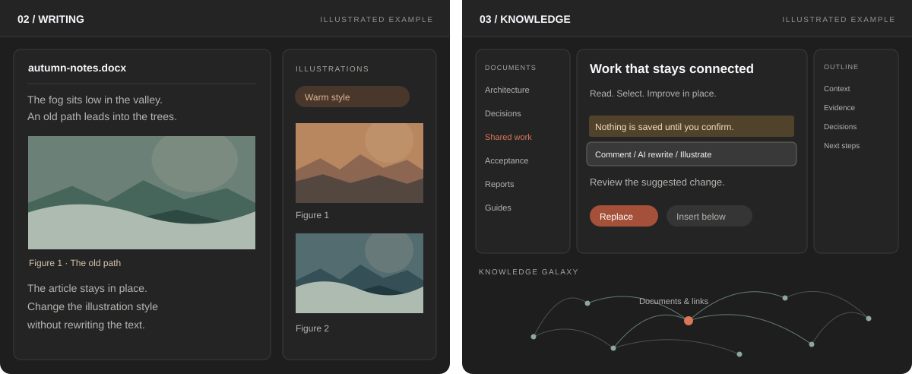
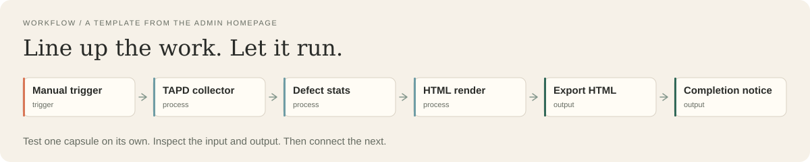
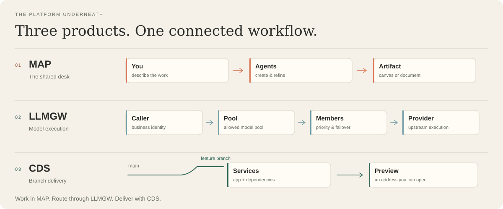

<p align="center">
  
</p>

<p align="center">
  <a href="https://map.ebcone.net/home"><strong>Explore MAP</strong></a> &nbsp; / &nbsp;
  <a href="https://github.com/inernoro/prd_agent/releases/latest">Download desktop</a> &nbsp; / &nbsp;
  <a href="#the-work-you-can-do">Product tour</a> &nbsp; / &nbsp;
  <a href="#build-delivery--health">Project status</a> &nbsp; / &nbsp;
  <a href="#start-with-one-useful-thing">Start here</a>
</p>

<p align="center">
  <a href="https://github.com/inernoro/prd_agent/releases/latest"></a>
  <a href="https://github.com/inernoro/prd_agent/releases"></a>
  <a href="https://github.com/inernoro/prd_agent/commits/main/"></a>
</p>

**MAP brings specialist agents into one shared workspace.** Create and refine images on an infinite canvas. Write an article and illustrate it by paragraph. Read, rewrite, and connect knowledge in place. Turn repeatable work into a workflow, with model execution and branch delivery handled by dedicated layers underneath.

This repository, `prd_agent`, contains three products: **MAP**, the Midoo Agentic Platform; **LLMGW**, the model gateway; and **CDS**, Cloud Dev Suite.

## The work you can do

### 01 / A canvas, with a designer alongside.

Generate, select, refine, and combine images in the same workspace. The infinite canvas keeps the variations in view; the assistant stays beside them. Image actions include upscaling, background removal, expansion, inpainting, and AI layers.

<picture>
  <source media="(max-width: 640px)" srcset="assets/readme/visual-workspace-mobile.svg" />
  
</picture>

<sub>Interface studies use example content and follow the admin homepage scenes. [Visual scene source](prd-admin/src/pages/home/scenes/VisualCanvasScene.tsx).</sub>

<br />

### 02 / Write with illustrations. Read in context.

The writing workspace keeps the article on the left and its illustration bench on the right. Generate illustrations by paragraph meaning; change their style while keeping the text intact.

The knowledge reader keeps files, document, and outline together. Select a passage to comment, rewrite, or illustrate it. Review the suggested edit before confirming it; explore relationships between documents in the knowledge galaxy.

<picture>
  <source media="(max-width: 640px)" srcset="assets/readme/writing-knowledge-mobile.svg" />
  
</picture>

<sub>[Writing scene](prd-admin/src/pages/home/scenes/LiteraryScene.tsx) &nbsp; / &nbsp; [Knowledge scene](prd-admin/src/pages/home/scenes/KnowledgeScene.tsx)</sub>

<br />

### 03 / Give repeatable work a workflow.

Connect trigger, process, control, and output capsules on a canvas. Start from a template, inspect one capsule's input and output, then connect the next. Workflows can run on a timer or respond to a webhook.

<picture>
  <source media="(max-width: 640px)" srcset="assets/readme/workflow-strip-mobile.svg" />
  
</picture>

<sub>The illustrated chain comes from the [homepage's TAPD template](prd-admin/src/pages/home/i18n/landing.ts). [Workflow scene source](prd-admin/src/pages/home/scenes/WorkflowScene.tsx).</sub>

## A toolbox organized around the work

The registry contains **30+ agents and tools**, grouped here by the work they help with. Preview entries retain their product labels.

| Create | Deliver | Retain | Coordinate |
| :--- | :--- | :--- | :--- |
| Visual agent | PR review agent | My shares | AI arena |
| Writing agent | Frontend partner **(Preview)** | Weekly report agent | Project management **(Preview)** |
| Video agent | CDS agent **(Preview)** | Markdown to slides | Product management **(Preview)** |
| Storyboard bench **(Preview)** | Defect reporting | Transcription bench | Blunt secretary **(Preview)** |

Search the Toolbox by the task you need to finish. The [tool registry](prd-admin/src/stores/toolboxStore.ts) and [homepage catalog](prd-admin/src/pages/home/i18n/landing.ts) define the entries and their availability.

## Three layers, one connected system

**MAP is the desk. LLMGW handles model execution. CDS delivers a working branch.** Each product can be used independently; together they connect the work, the compute, and the environment where the result can be reviewed.

<picture>
  <source media="(max-width: 640px)" srcset="assets/readme/platform-layers-mobile.svg" />
  
</picture>

The gateway manages member selection, health, and retries within the selected model pool. Cross-pool substitution requires explicit authorization. CDS handles branch builds, preview routing, reusable versions, deployment records, and rollback.

<p align="center">
  <a href="prd-admin/src/pages/home/scenes/LayersScene.tsx">Homepage layer view</a> &nbsp; / &nbsp;
  <a href="doc/design.platform.llm-gateway.md">Gateway design</a> &nbsp; / &nbsp;
  <a href="cds/README.md">CDS guide</a>
</p>

<details>
<summary>Explore the implementation map</summary>

| Component | Responsibility | Source |
| :--- | :--- | :--- |
| MAP backend | .NET API, product operations, and background workers | [prd-api](prd-api/) |
| Web console | React interface for the workspace and administration | [prd-admin](prd-admin/) |
| Desktop client | Tauri desktop application | [prd-desktop](prd-desktop/) |
| LLM gateway | Model execution and request governance | [llmgw](llmgw/) |
| Cloud Dev Suite | Branch builds, previews, and delivery records | [cds](cds/) |
| Agent SDK sidecar | Supporting Agent SDK service | [claude-sdk-sidecar](claude-sdk-sidecar/) |

</details>

## Build, delivery & health

<table>
  <tr><th width="33%">Build &amp; test</th><th width="33%">Container delivery</th><th width="34%">Operations</th></tr>
  <tr>
    <td align="center" valign="top"><a href="https://github.com/inernoro/prd_agent/actions/workflows/ci.yml?query=branch%3Amain"></a><br /><br /><a href="https://github.com/inernoro/prd_agent/actions/workflows/cds.yml?query=branch%3Amain"></a></td>
    <td align="center" valign="top"><a href="https://github.com/inernoro/prd_agent/actions/workflows/server-deploy.yml?query=branch%3Amain"></a><br /><br /><a href="https://github.com/inernoro/prd_agent/actions/workflows/branch-image.yml?query=branch%3Amain"></a></td>
    <td align="center" valign="top"><a href="https://map.ebcone.net"></a><br /><br /><a href="https://github.com/inernoro/cds-independent-status/actions/workflows/watchdog.yml?query=branch%3Amain"></a><br /><br /><a href="https://github.com/inernoro/prd_agent/actions/workflows/cds-external-port-audit.yml?query=branch%3Amain"></a></td>
  </tr>
</table>

Build badges show the latest matching `main` run. Container badges track image publication. The web probe measures HTTP reachability; the external watchdog badge tracks its scheduled heartbeat-check job. The port audit runs daily. Open a badge for the source evidence and timestamps; schedules and badge refreshes can be delayed.

<p align="center">
  <a href="https://github.com/inernoro/prd_agent/actions">Build history</a> &nbsp; / &nbsp;
  <a href="https://github.com/inernoro/cds-independent-status/actions/workflows/watchdog.yml">Heartbeat check history</a> &nbsp; / &nbsp;
  <a href="https://github.com/inernoro/prd_agent/actions/workflows/preview-acceptance.yml">Preview acceptance</a>
</p>

## Start with one useful thing

### Open the web workspace

Open [MAP](https://map.ebcone.net/home), sign in, and choose an agent from the Toolbox. Describe one task; work with the result on its canvas or in its document. The homepage introduces the visual, writing, knowledge, workflow, model, and delivery surfaces before you sign in.

### Download the desktop app

The [latest release](https://github.com/inernoro/prd_agent/releases/latest) includes installers for **macOS, Windows, and Linux**. Open the release assets to choose your operating system and architecture. See [all releases](https://github.com/inernoro/prd_agent/releases) for previous versions and published assets.

### Develop locally

Use the development Compose stack from a checkout of this repository with Docker and Compose available. On a fresh database, supply `MAP_INITIAL_ADMIN_USERNAME` and `MAP_INITIAL_ADMIN_PASSWORD` through your environment or a local `.env` file; the initializer validates this credential pair before creating the first administrator. See the [environment template](.env.template) for the broader configuration reference.

```bash
docker compose -f docker-compose.dev.yml up -d --build
```

Open **[http://localhost:5500](http://localhost:5500)** for the web console and sign in with that administrator account. Model-backed features also require configured providers and credentials through the gateway.

| Service | Development address |
| :--- | :--- |
| Web gateway and admin console | `http://localhost:5500` |
| API | `http://localhost:5000` |
| MongoDB | `mongodb://localhost:18081` |
| Redis | `localhost:18082` |

<details>
<summary>Local development shortcuts</summary>

Use the existing launchers when developing with the local toolchains and configured infrastructure:

```bash
./quick.sh          # API + local LLM gateway serving
./quick.sh admin    # web console
./quick.sh all      # API + gateway + web console + desktop
```

Windows:

```powershell
.\quick.ps1
.\quick.ps1 all
```

The full desktop workflow uses the .NET, Node/pnpm, Rust, and Tauri development toolchains. Frontend packages use **pnpm**.

</details>

<details>
<summary>Build and check individual modules</summary>

Backend, from `prd-api/`:

```bash
dotnet build --no-restore
dotnet test tests/PrdAgent.Tests/PrdAgent.Tests.csproj --no-restore --filter "Category!=Integration&Category!=Manual"
```

Web console, from `prd-admin/`:

```bash
pnpm install
pnpm dev
pnpm tsc --noEmit
pnpm lint
```

Desktop, from `prd-desktop/`:

```bash
pnpm install
pnpm tauri:dev
```

The test command above selects the non-integration, non-manual suite. See [AGENTS.md](AGENTS.md) for scope-specific checks, CI requirements, and integration test rules.

</details>

<details>
<summary>Start Cloud Dev Suite and manage deployments</summary>

From the repository root:

```bash
./exec_cds.sh init
./exec_cds.sh start
./exec_cds.sh status
```

The CDS initialization flow prepares its configuration. See the [CDS guide](cds/README.md) for Agent onboarding, managed delivery, previews, and recovery.

List the CDS acceptance scenarios:

```bash
./scripts/cds-acceptance-test.sh --list
```

Project deployment entrypoint:

```bash
./exec_dep.sh
```

Local production-like builds:

```bash
./local_exec_dep.sh up
```

Use the deployment entrypoint with the environment configuration for your intended target. The development Compose stack is the local development path.

</details>

## Explore the project

| For | Start here |
| :--- | :--- |
| The product and its story | [Admin homepage](prd-admin/src/pages/home/LandingPage.tsx) · [English and Chinese product copy](prd-admin/src/pages/home/i18n/landing.ts) |
| Product workflows | [Product Agent design](doc/design.product-agent.md) |
| Model pools and responsibility boundaries | [LLM gateway design](doc/design.platform.llm-gateway.md) |
| Branch previews and managed delivery | [CDS guide](cds/README.md) · [CDS architecture](doc/design.cds.md) |
| Knowledge shared across systems | [Peer sync design](doc/design.platform.peer-sync.md) |
| Contributor rules and checks | [AGENTS.md](AGENTS.md) |
| Changes across releases | [Changelog](CHANGELOG.md) |

<details>
<summary>Repository and documentation conventions</summary>

The root keeps project entrypoints and top-level documentation. Supporting material lives with its owning module:

| Path | Contents |
| :--- | :--- |
| `doc/` | Specifications, designs, plans, rules, guides, reports, and debt notes |
| `scripts/` | Build, smoke, migration, acceptance, and maintenance tooling |
| `e2e/` | Automated tests, manual probes, and test fixtures |
| `assets/` | Static artwork, reference assets, and archived prototypes |
| `.design/` | Editable design sources |
| `changelogs/` | One changelog fragment per change set |
| `deploy/` | Deployment support files |

Documentation uses the prefixes `spec.`, `design.`, `plan.`, `rule.`, `guide.`, `report.`, and `debt.`. See [AGENTS.md](AGENTS.md) for naming, directory, change-record, and quality requirements.

</details>

## License

MIT

---

<p align="center"><strong>MAP · Create, freely.</strong><br /><sub>Pick one agent. Finish one useful thing. Keep the result.</sub></p>
