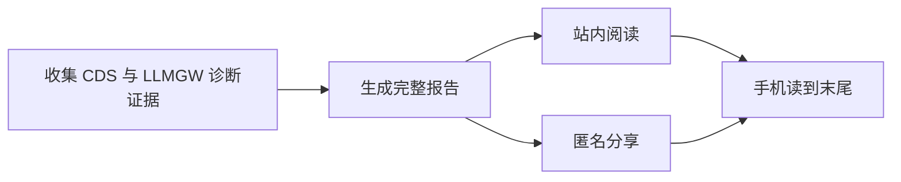
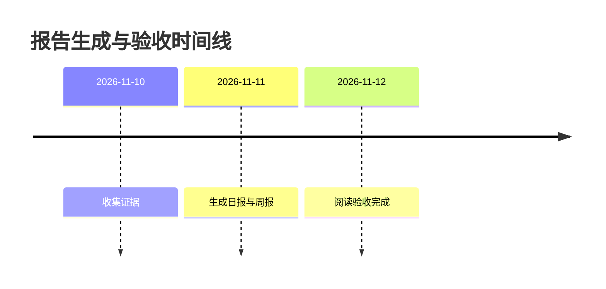

# CDS 与 LLMGW 诊断日报、周报、月度总结及验收报告固定样本：长标题必须完整保留，手机阅读也不能省略验收结论和关键证据

[跳到末尾](#完整阅读终点)

## 关键结论

本报告包含 8 列完整表格、代码、真实流程图、时间线、图片与长链接。所有入口应保留相同证据。

| 对象 | 环境 | 请求数 | 成功率 | 延迟 P95 | 失败原因 | 恢复方式 | 末列证据 |
| --- | --- | --- | --- | --- | --- | --- | --- |
| CDS 报告 | 预览 | 120 | 99% | 900ms | 网络超时 | 重新加载 | LAST-COLUMN-CDS |
| LLMGW 诊断 | 测试 | 240 | 98% | 1200ms | 上游限流 | 等待后重试 | LAST-COLUMN-LLMGW |

```json
{"model":"diagnostic-model","request_id":"REQUEST-CODE-END","evidence":"完整的代码不会换行丢失或截断，横向滚动保留源格式"}
```

## 流程图



## 时间线



## 图片


## 图表解析失败

```mermaid
flowchart LR
  A[未闭合
```

## 长链接

https://example.com/?report=cds-llmgw-diagnostic-daily-weekly-monthly-acceptance-evidence-with-a-very-long-unbroken-link-123456789012345678901234567890123456789012345678901234567890

## 完整阅读终点

READING-END：所有列、源代码、流程图、时间线、图片说明和关键链接均保留。可返回报告首页。
