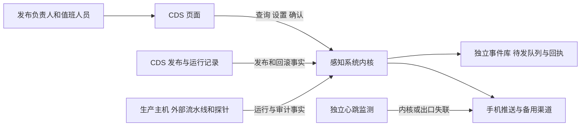

# 感知系统架构 · 设计

> **版本**：v0.1 | **日期**：2026-11-19 | **状态**：评审中

**一句话**：CDS 承载页面并提供发布事实，感知系统内核独立接收事件、判断紧急程度、投递和保存回执。
**谁该读**：生产发布负责人、值班人员和感知系统维护者。
**读完能做什么**：判断各项数据由谁掌管、CDS 停机时哪些能力仍可用，以及每一步接入需要什么证据。

## 用户能看到什么

- 我能收到已登记正式目标的发布、回滚和重启通知。发布开始与结果关联到同一运行记录，点击可查看版本、触发人、时间和验证结果。预发与分支预览沿用各自的订阅。
- 我能在 CDS 页面查看事件、管理授权范围内的订阅、确认事故。通知说明受影响的系统、环境、已确认的影响与当前状态。控制面短时离线时，感知系统继续接收其他来源的事件并发送通知。
- 日常变更走普通推送。需要立即介入的事件使用独立的优先队列，支持备用渠道、人工确认、超时升级和恢复通知。

## 现状和设计目标

现有外部探针和 Bark 发送进程已经独立运行。接收端有自己的队列、回执和加密接收能力，可以在 CDS 暂时不可达时继续处理已接收的消息。CDS 当前仍保存待转发事件、通道和订阅，并按订阅选择接收人。正式变更新接线已有本地提交和专项验证，生产接入及真机收到通知仍待验收。

目标架构由感知系统内核直接掌管接收后的事件、规则、订阅、队列和回执。保留已验证的外部探针、短讯模板和手机投递能力。接入前先核对实际运行实例及数据归属，再确定哪些能力可直接复用。当前的独立发送进程证明了投递侧可独立运行，完整内核的独立性以冷启动验收为准。[CDS 通知验收边界](./debt.cds.notification.md)

## 系统边界与数据流

| 组件 | 职责 |
| --- | --- |
| CDS 页面与事件适配 | 承载界面、用户身份和项目权限校验，转交授权请求。对自身发布、回滚和相关健康验证给出事实及原始记录。未被内核确认的 CDS 事件先持久保留，恢复后补交。 |
| 感知系统内核 | 接收可信的结构化事件，归并变更或事故，判断紧急程度，按订阅投递，记录重试、回执、人工确认与恢复。拥有独立托管的规则、订阅、状态和投递凭据。 |
| 生产事件来源 | 外部流水线报告实际发布与回退。宿主机或编排平台审计报告应用重启。配置系统、迁移工具和探针报告各自可证明的事实。生产侧来源可直达内核。 |
| 独立心跳监测 | 从内核之外验证事件源的心跳、内核处理进度与渠道可用性。主链路失联时，经独立备用渠道告警。 |

内核以 CDS 之外的进程及宿主机部署，使用独立持久存储、源凭据和发布入口。内核接收生产事件、冷启动和发送通知这一条路径，在 CDS 及其数据库、域名入口或登录服务不可达时仍应成立。CDS 页面离线期间，可以通过通知的独立状态入口查看事故摘要和接手方式。涉及项目详情和订阅修改的操作仍需授权，提交成功以感知系统的写入回执为准。

## 事件、事故与投递状态

| 记录 | 关键内容与规则 |
| --- | --- |
| 来源事件 | 保留事件来源、发生与接收时间、环境、项目与对象、操作人或触发方式、运行编号、结果和证据。环境以已登记目标与可信来源为准。来源不明的记录标为待核对，留存供排查。 |
| 生产变更 | 以一个运行编号关联受理、开始、结果和恢复证据。发布脚本结束后，还需按正式入口验证结果确定是否成功。自动回退成功时保留「发布失败」及「已恢复上一版本」两个事实。滚动重启归入对应发布，独立重启留存自身记录。 |
| 紧急事故 | 按受影响系统、环境和症状关联持续观测。显式区分首次告警、已确认、升级、恢复和复发。恢复需有主动健康证据，采样缺失显示为状态未知。 |
| 订阅与投递 | 保存订阅范围及规则版本，记录发送渠道、尝试时间、服务受理、失败或结果待核实。手机显示、人工确认和推送服务受理各有证据。 |

内核持久保存事件后才向来源确认。来源收到确认后才移出待交付队列。重复提交用同一来源事件编号去重，跨来源归并需有同一发布运行编号或等价证据，保留各方原始记录。相互独立的重启不会按目标和时间窗口被删掉，批量推送可汇总次数并提供可追溯入口。对明确可重试的投递按通道策略退避。Bark 响应超时记为结果待核实，避免盲目重发，同一紧急事故仍可走备用渠道。

来源只能上报获准项目及事件类型。通道凭据由内核持有，CDS 页面控制查询和操作权限，内核也按项目与角色校验。通知与公开摘要只展示脱敏信息，详细审计记录留在授权范围内。[通知分类与短讯模板](./design.platform.notification.templates.md)

## 四类紧急告警

| 类型 | 升级依据 |
| --- | --- |
| 核心业务中断 | 核心链路满足已确认的故障判据，或正式变更的最终入口验证失败且尚无恢复证据。记清受影响入口、验证时间和最后的恢复动作。 |
| 生产数据丢失或无法恢复 | 确认发生生产数据丢失、损坏或关键数据写入中断，或备份、复制和恢复验证显示已无法满足既定恢复目标。 |
| 生产权限失控 | 确认出现未经授权的生产提权、高危操作或生产凭据泄露。记录来源和影响范围，敏感细节留在受限的审计记录。 |
| 监控或通知失明 | 关键探针停止报告、内核处理停滞或主投递链路不可用，且超过各自的心跳或投递判据。由链路之外的监测方触发备用通知。 |

故障得到确认后进入优先队列。主渠道明确失败时启动备用渠道。在值班确认时限内无人接手时，升级给备用值班人。业务负责人和值班人员共同确定核心链路、恢复目标、确认时限及收件人。规则在演练中验证后再启用。

## 接入与切换

1. **先接 CDS 事件。** 复用现有发布记录、已登记正式目标与加密接收链路。CDS 旧队列保留待转发事件。核对从页面保存订阅到发送回执的实际读写归属，记录仍依赖 CDS 的环节。
2. **再接感知系统内核。** 核对独立运行实例、存储和凭据。先验证内核接收、规则判定、独立冷启动和确认回执；再由已登记的渠道逐步切换正式变更。切换前后明确唯一发送归属，新旧进程不得同时对同一目的地发送同一事件。回滚保留未完成队列和已发送回执。
3. **扩展生产来源与值班。** 逐项登记生产主机、外部流水线、配置和数据库变更入口，依据权威记录补齐覆盖。最后按四类紧急事件验收主备渠道、确认、升级及恢复。执行进度和阻塞在同一份验收清单维护。[感知系统接入与验收计划](https://chatgpt.com/space/page_08b5a5a836c88191a0854fcc82a8b94a)

## 验收判据

| 场景 | 通过条件 |
| --- | --- |
| CDS 正式发布、回滚和预发对照 | 正式通知的开始、结果及恢复状态可回到同一运行记录。两次连续发布各有回执，重复事件合并。预发和分支预览不触发正式订阅。 |
| CDS 停机与内核冷启动 | 在隔离环境停掉 CDS，并阻断内核对该 CDS 及其存储的访问。冷启动内核后，由另一可信来源发送一条新事件。核对内核独立完成接收、判定、投递及回执落盘，并用独立探针确认 CDS 失联。 |
| CDS 恢复与补交 | 在 CDS 停机前保留一条待交付事件，恢复后确认它被感知系统接收。已受理的事件即使重放也只产生一次对应投递。补交后的事件能回到原始运行记录。 |
| 直接操作生产应用 | 宿主侧操作能记录应用重启；配置生效和数据库迁移能关联审计证据。每类事件都按登记范围验收，未接入目标在覆盖表中可见。 |
| 主渠道或内核中断 | 模拟主渠道拒绝、无人确认、内核停止处理等情形。备用渠道可独立送达，并留下确认与升级记录。恢复后仍可查到积压和待核实回执。 |
| 升级、回滚和手机验收 | 内核升级或回滚后保留待发队列与回执。抽查同一事件的来源证据、推送服务受理和真机显示。 |

首轮评审确认三个决策。独立内核的现役实例与存储由谁接管；哪些正式目标和事件来源优先接入；紧急通知的备用渠道与值班确认时限由谁设定。任何一项尚无可验证的运行证据时，保留在验收计划中。
