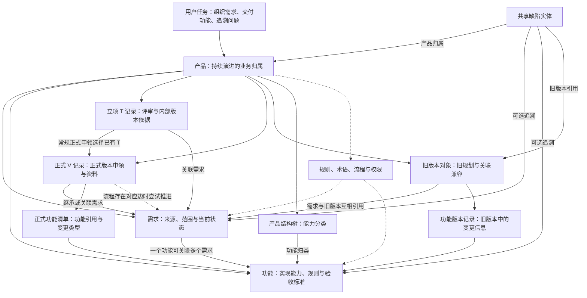

# 产品管理智能体：产品结构与承重契约 · 设计

> **版本**：v2.0 | **日期**：2026-11-06 | **状态**：现状说明；运行与价值效果未复验

**一句话**：以产品为归属边界，区分旧版本、立项与正式上线记录，把需求、功能和缺陷的关系及状态承诺解释清楚。
**谁该读**：要理解产品管理业务、评估变更影响或接手需求与版本流程的产品、工程和测试人员。
**读完能做什么**：指出业务的根基与承重结构，分清不同版本口径，并找到当前行为、决策依据与待解决冲突。

## 一、管理摘要

产品管理服务持续演进的产品：让需求能追溯到来源、交付范围和结果，让后来者知道一项功能为何存在、归属哪里、出了问题该查什么。这个价值来自既有定位；是否减少了用户沟通和返工，尚未通过用户研究或运行数据证明。

本图与下文以 2026-11-06 工作区源码为静态基线。可以确认对象与处理路径，不把“源码存在”写成“所有线上场景已经通过”。现行规格见[正式版本申领与历史追溯](./spec.product-agent.version-claims.md)，重要产品选择见[申领与后续资料分离的决策补录](./pdr.product-agent.002.version-claim-boundary.md)。

最大的理解风险是把所有“版本”当成同一种对象：旧版规划对象、立项 T 记录、正式 V 记录和功能版本各有职责；需求状态、版本发号成功和真实部署成功也不是同一证据。

## 二、用户任务与产品边界

| 角色与任务 | 应得到的结果 | 尚待验证的价值假设 |
| --- | --- | --- |
| 产品人员接收与组织需求 | 来源、业务对象、交付范围与当前状态能被查明 | 查找依据与反复解释的耗时减少 |
| 研发安排与实现功能 | 需求、计划版本、关键规则与验收标准一致 | 口径误解引起的返工减少 |
| 测试发现与追溯缺陷 | 缺陷可以关联产品及具体需求、功能或旧版本 | 能更快判断影响面与回归范围 |
| 后来者接手维护 | 当前行为、历史依据和已知边界可分别定位 | 无需找到原当事人也能正确理解一个实例 |

产品管理与项目管理是不同业务范围：前者管理持续演进的产品及交付关系；后者管理临时项目、任务、里程碑与评价。本篇不再混写项目管理的功能更新，其历史欠账仍见[模块债务](./debt.product-agent.md#项目管理智能体)。

## 三、产品结构与依赖图

实线表示源码中可确认的归属或引用关系；虚线表示支撑性约束或有条件的联动。图中的对象关系不保证多处更新具备跨集合事务，也不等于完整历史快照。

临时优化走专门通道，不关联 T；不能把图中的常规 T→V 关系推广成所有上线记录的必经关系。当前缺陷版本追溯使用旧版本引用，没有证据表明它自动关联正式 V 记录。

## 四、核心对象的当前含义

| 对象 | 当前职责与关系 | 变更时必须注意 |
| --- | --- | --- |
| 产品 | 关联成员与负责人，作为需求、功能、版本记录和产品内权限的归属 | 产品归属是业务引用与权限判断的重要边界，不能只改名称就推定数据已迁移 |
| 需求 | 保存诉求、来源、状态与客户关系，可关联多个旧版本；也被立项和上线记录引用 | 旧版本关联与 T/V 关联是不同关系，不能按展示名称混用 |
| 功能 | 保存实现能力、主需求与关联需求、计划旧版本、正式上线归属，以及关键规则与验收标准 | 一个正式功能清单条目主要保存引用与变化类型，不自动冻结整份功能正文 |
| 立项 T 记录 | 保存评审来源、业务负责人、需求范围和内部版本号 | 实际提交人、业务负责人及历史审批人是不同身份；新流程不能默认还需旧人工审批 |
| 正式 V 记录 | 常规路径继承已有 T 的资料，另保存正式申领信息、范围与公告链接 | 发号、资料补齐、需求状态与部署证据分别解释 |
| 旧版本与功能版本 | 保持旧版规划、功能变化和关联路径兼容 | 仍可在控制器中看到写入路径，不能仅因主界面已使用 T/V 就宣称只读 |
| 缺陷 | 复用共享缺陷实体，以产品及可选需求、功能、旧版本引用建立追溯 | 对象复用不代表可以绕过产品访问范围；不能假设引用永远完整 |

客户是共享目录，产品术语与规则属于产品范围；具体访问权限仍以现行鉴权为准。知识库复用已有文档空间，不重新建立另一套知识存储。

## 五、承重结构与允许变化的政策

| 层次 | 当前可确认的依赖 | 改变会影响谁 | 应如何处理 |
| --- | --- | --- | --- |
| 根：用户任务与价值 | 已有愿景以共享理解、执行和追溯为方向 | 产品、研发、测试与后来者 | 用真实任务验证价值；新证据允许改变定位 |
| 业务骨架 | 产品归属、对象含义和多种版本关系 | 权限、统计、导入、列表与图谱 | 重要语义变化记 PDR，写清新旧对象迁移或兼容 |
| 编号与来源承诺 | 正式申领检查 T 来源、防重与编号占用 | 正式记录、重复提交、历史导入 | 不能把重试、删除或代码回退等同于回收已发号码 |
| 状态承诺 | 手动需求流转检查角色、字段及业务依据；正式发号另有自动推进路径 | 页面操作、状态统计和验收 | 明确每条入口何时写状态、哪些条件会跳过 |
| 历史解释 | 已有导入存档、评审尝试、活动记录和部分评分快照 | 排障、复算与后续维护 | 按具体载体评估覆盖，不宣称全系统已经版本化 |
| 可变政策 | 评审参数、培训要求、公告补录、可配置流程等 | 具体业务场景与在途对象 | 写明范围、优先级与生效条件；改变重要承诺时再建立决策 |

承重不意味着永远不能改变，而是不能当作局部页面改动。反过来，展示布局、提示文案等通常可以独立调整，但改变授权或公开含义的按钮也可能触及承重契约。

## 六、两条需要区分的状态路径

手动需求流转从用户选择动作开始，页面提示缺失内容；服务端再核对产品访问、当前状态、允许角色和必填项。进入已立项时需要已有有效立项关联或所选有效立项；进入已排期时要求有归属版本；进入已上线时需要已有或所选已完成上线记录。通过后写入状态并保存活动记录。

正式版本申领是另一条路径：服务端校验常规 T 来源、历史关联和重复申领，检查必填资料，生成 V 号并保存正式记录；随后尝试推进关联需求。当前实现只有在所选流程中存在对应流转边时才推进，不能保证所有关联需求无条件变成已上线。

这意味着“正式记录成功”“所有需求状态同步完成”“部署已可用”不能相互替代。当前排期闸门只检查版本集合非空，未在该闸门中证明版本存在且属于同一产品，这一边界已登记到债务清单。

## 七、历史资料的能力与边界

现有载体提供不同粒度的证据：版本工作流存档保存 T/V 记录集合；评审尝试保存结果引用和部分评分；活动记录保存操作人与前后显示值；需求评估保存部分评分规则快照。它们不能互相冒充完整历史。

产品规则和流程定义当前可以覆盖更新，业务对象通常保存定义引用而非完整规则版本。因此“看得到某次操作”不等于“能恢复当时全部规则”，也不等于“可以重算原结果”。改进提议见[规则历史适用决策](./pdr.product-agent.001.rule-evolution.md)。

## 八、冲突、风险与验收

[模块债务中的决策治理清单](./debt.product-agent.md#产品结构与决策治理2026-11-06)是冲突与关闭条件的权威入口。本轮先修正文档中已经有证据解释的旧口径，保留仍需业务判断或运行验证的项。

本轮使用已有真实变更“正式申领资料简化与后续公告分离”进行决策回放，范围、正常与异常实例及证据层次见[现状规格](./spec.product-agent.version-claims.md)。这次回放不触发真实发号、不修改生产资料，也不代替登录态端到端验收。

## 实现来源

- [产品与负责人](../prd-api/src/PrdAgent.Core/Models/Product.cs)、[需求](../prd-api/src/PrdAgent.Core/Models/Requirement.cs)、[功能与功能版本](../prd-api/src/PrdAgent.Core/Models/Feature.cs)、[旧版本](../prd-api/src/PrdAgent.Core/Models/ProductVersion.cs)、[T/V 与存档](../prd-api/src/PrdAgent.Core/Models/ProductVersionWorkflow.cs)、[缺陷追溯](../prd-api/src/PrdAgent.Core/Models/DefectReport.cs)。
- [产品业务处理与存储关系](../prd-api/src/PrdAgent.Api/Controllers/Api/ProductAgentController.cs)、[产品权限](../prd-api/src/PrdAgent.Core/Security/ProductPermissionRules.cs)、[需求业务闸门](../prd-api/src/PrdAgent.Core/Models/RequirementWorkflowTransitionGates.cs)、[流程角色和字段校验](../prd-api/src/PrdAgent.Core/Models/ProductWorkflowTransitionGuard.cs)。
- [流转弹窗](../prd-admin/src/pages/product-agent/WorkflowTransitionDialog.tsx)、[前端流转判断](../prd-admin/src/pages/product-agent/workflowTransitionGuard.ts)、[客户端业务入口](../prd-admin/src/services/real/productAgent.ts)。
- [正式申领源码契约测试](../prd-api/tests/PrdAgent.Api.Tests/Services/ProductVersionClaimGuardTests.cs)、[前端流转测试](../prd-admin/src/pages/product-agent/workflowTransitionGuard.test.ts)。引用测试表示存在可检查的断言，不代表本轮已执行所有测试。
